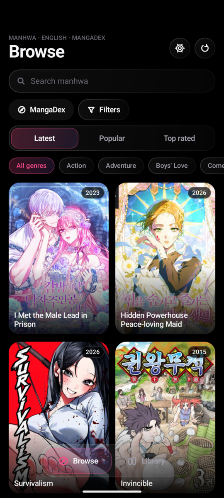
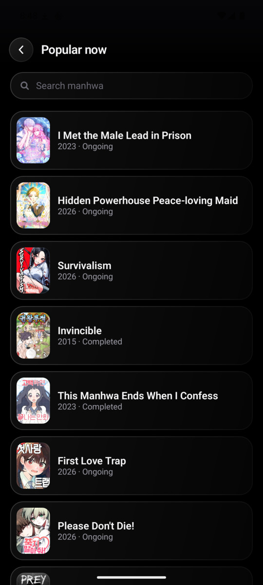
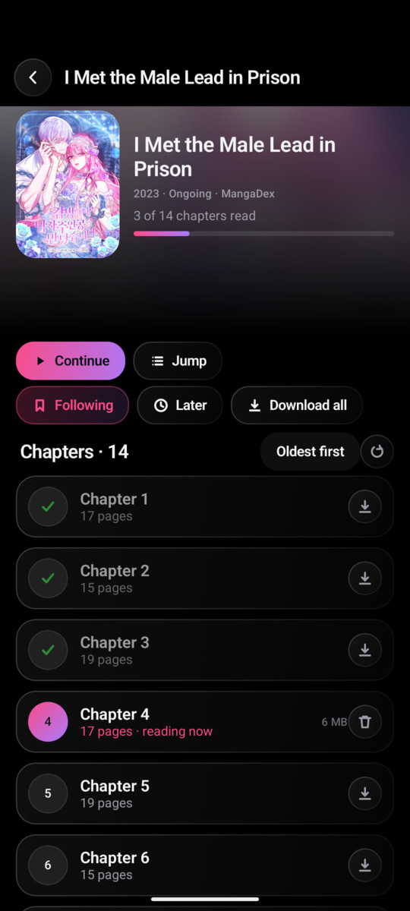
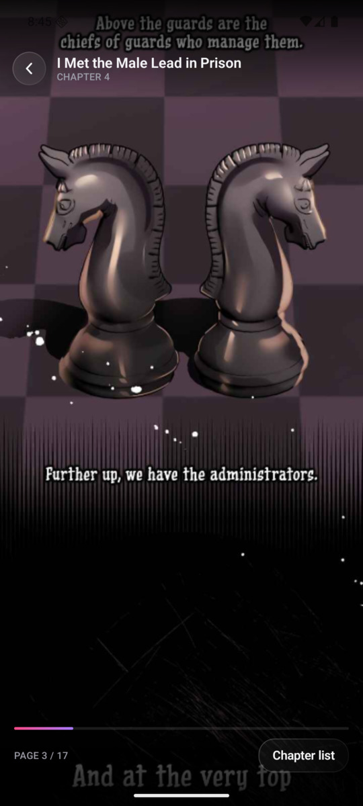
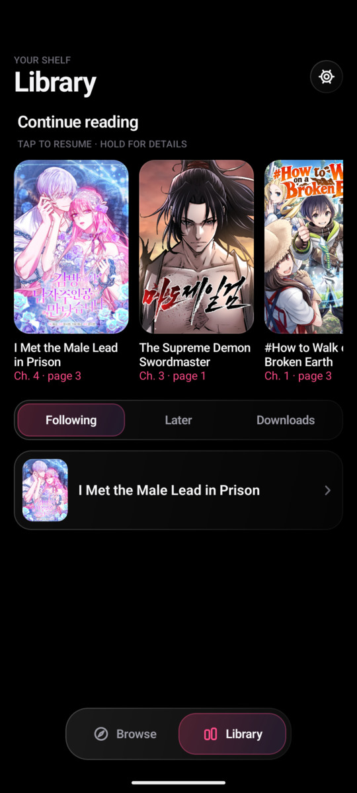
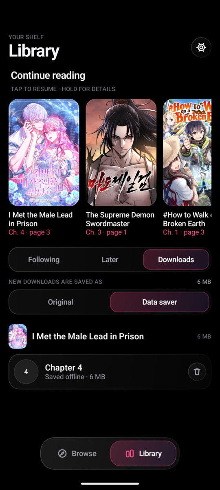
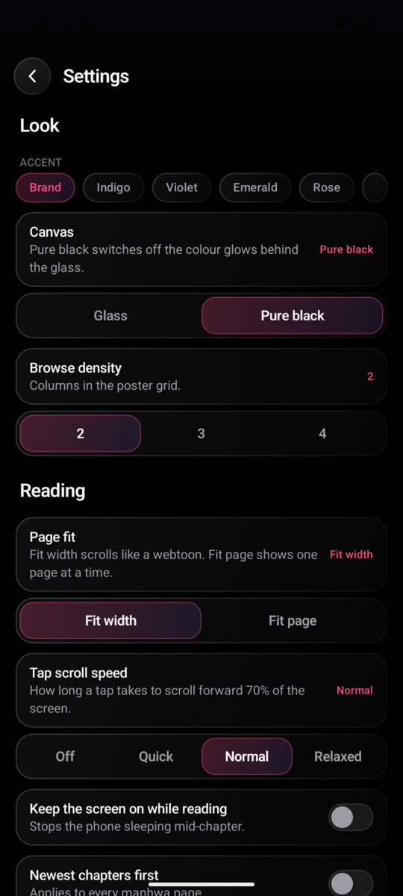
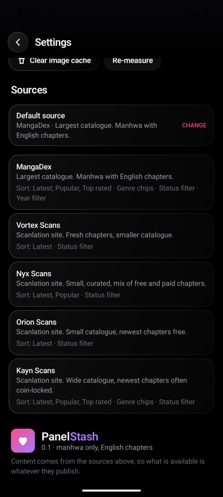
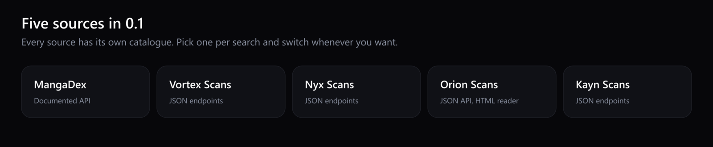
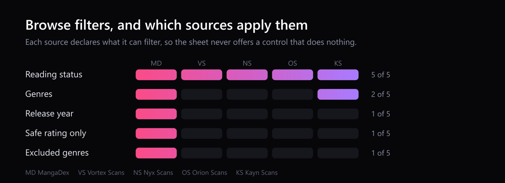

<div align="center">
  
</div>

<div align="center">


</div>

PanelStash is an Android app for reading manhwa. It renders chapters from twelve catalogue sources, keeps your place across them, and saves chapters to the device so you can read with no connection at all. There is no account and no server: everything it knows lives on the phone.

It is built for one hand and a slow connection. Pages arrive sized to the screen, a chapter reopens on the page you left, and a tap moves you forward a screenful.

## Screenshots

|  |  |
|:--:|:--:|
| <sub>Browse one source or all of them, with the sorts and filters each can apply.</sub> | <sub>Search one source or all of them; an empty field shows the popular list.</sub> |
|  |  |
| <sub>Progress, follow, read later, download all, and a chapter list that marks what you finished.</sub> | <sub>A tap scrolls 70% of the screen in 300, 500 or 700 ms. The bars follow the scroll direction.</sub> |
|  |  |
| <sub>Continue reading at the exact page, plus following, later and downloads.</sub> | <sub>Downloaded chapters live as files and open without a network.</sub> |
|  |  |
| <sub>Theme, accent, canvas, grid density, page fit and tap scroll speed.</sub> | <sub>Every source lists what it can filter before you pick it.</sub> |

## What it does

Reading:

- Streams a chapter page by page, or reads it from disk when you have downloaded it.
- Remembers the chapter and the exact page, then offers Continue on the manhwa page.
- Marks a chapter read once you reach its last page, greys it out, and shows a ring at the end of a chapter that advances to the next one.
- Long-press toggles a chapter's read state, so a mis-tap does not lose your place in the list.
- Page fit is either fit width, which scrolls like a webtoon, or fit page, which shows one page at a time.

Library:

- Following and read-later shelves, both one tap from the manhwa page.
- Continue reading ordered by what you opened last.
- Following, Later and Downloads are pages you swipe between, or tap the control to jump.
- Downloads, with the quality used per chapter and the space taken.
- Deleting a download can be undone for five seconds.

Finding something to read:

- Every source that publishes genres now hands them over, so a manhwa page lists what the title is filed under and recommendations can match on it.
- Browse by genre on the sources that can filter by one: MangaDex, Flame, Kayn, Asura, Arena and Mgeko.
- Narrow by status on MangaDex, Flame, Kayn, Nyx, Orion, Vortex, Arena and Mgeko, and by excluded genres on MangaDex, Flame and Mgeko.
- Above the Browse grid: a merged top ten, a "More in <genre>" row drawn from the genres you read most, and a "Because you read" row per recent title. The genre row carries a chip that opens Browse filtered to that genre.
- When two sources carry the same title, the copy with more chapters wins, so a licensed entry with a handful of chapters cannot stand in for a scanlation with hundreds.
- Chapters a site only links to and cannot serve are left out. Everything a manhwa page lists opens in the reader.

Downloads:

- Whole comics download chapter by chapter, and each chapter is a normal file on the device.
- Original quality for the saved copy, data saver for streaming, or data saver for both.
- The queue waits for an unmetered connection by default and pauses when Wi-Fi drops.

Look:

- Dark or light, with two canvases in either: glass, with soft colour behind the panels, or pure (black in dark mode, white in light).
- Six accent colours.
- Poster grid at two, three or four columns.
- A tap scrolls forward in 300, 500 or 700 ms.
- Keep the screen awake while reading, and chapter lists either newest or oldest first.

## Sources

<div align="center">
  
</div>

- MangaDex: the widest catalogue, and the only site here with a documented API.
- Asura Scans: big catalogue. Premium and early-access chapters show as unreadable.
- Arena Scans: big WordPress catalogue with complete chapter lists and a full HTML reader. Its status filter only shows what the site files, which is nearly all ongoing.
- Flame Comics: mostly manhwa, newest chapters free.
- Lua Comic: curated manhwa catalogue. The newest chapters are coin-locked and show as unreadable.
- Vortex Scans: smaller catalogue, fresh chapters.
- Nyx Scans: small and curated, with some paid chapters.
- Orion Scans: small catalogue, newest chapters free. Detail, chapters and pages come from its JSON API.
- Kayn Scans: wide catalogue, though the newest chapters are often coin-locked.
- Mgeko: large aggregator with plain readers, a broad manhwa catalogue, and genre, excluded-genre and status filters that work.
- Weeb Central: big catalogue, and the chapter list arrives whole, so a 200 chapter run is one request.
- Mangapill: large catalogue with its own genre filter, so Browse can be narrowed there without leaving the app.

The list is also the precedence order: when two sources publish the same chapter, the one higher up wins. Browse opens on **All sources**, so the first screen is the whole catalogue rather than one site's slice of it; pick a source when you want only that one.

MangaDex is the only source with a documented API. The other eleven are scanlation sites that the app reads through the same endpoints and pages their own front ends use, so their payloads can change without warning. All twelve sit behind one interface, so the reader, the library and the downloads do not know which site served a chapter. Browse and search can also run across every source at once.

A source declares what it can do, and the filter sheet only offers those controls:

<div align="center">
  
</div>

Chapters are stored against the source that served them, so the same series from two sites is two entries rather than one mixed-up record. When a chapter is genuinely gone from one site, the app can offer the same chapter from another source before you start reading.

## Install

Grab the APK from the [releases page](https://github.com/ThoriaDevelopment/PanelStash/releases/latest), then open it on the phone and allow installing from this source when Android asks. The build is signed with a release key and targets Android 8.0 and newer.

There is no Play Store listing and no update check.

## Build from source

You need JDK 17 or newer and an Android SDK with platform 37 and a matching build-tools version.

```bash
git clone https://github.com/ThoriaDevelopment/PanelStash.git
cd PanelStash
./gradlew assembleDebug
```

On Windows use `.\gradlew.bat assembleDebug`. The APK lands in `app/build/outputs/apk/debug/`.

Unit tests cover the source mappings, chapter ordering, the cross-source merge and the genre tally:

```bash
./gradlew testDebugUnitTest
```

To build a signed release APK, create a key once and point the build at it. `keystore.properties` is not in version control, and neither are the `.jks` files:

```properties
# keystore.properties, at the repository root. Paths are relative to that root.
storeFile=panelstash-release.jks
storePassword=...
keyAlias=panelstash
keyPassword=...
```

Without that file the release build still runs and produces an unsigned APK, so nothing about signing is required to compile the project.

## What 0.3 leaves out

- New-chapter notifications and any polling for updates.
- Accounts, sync, and reading progress shared between devices.
- Titles without English chapters, and anything that is not manhwa.
- Genre filtering on Nyx, Vortex and Orion. They publish a title's genres but ignore every filter parameter, so Browse shows no chips for them and their profiles still show the genres.

## What changed in 0.3

- Genres on every source that publishes them, which brings genre chips to manhwa pages and genre-aware recommendations.
- Browse by genre on the four sources that honour it, plus the "More in <genre>" row built from what you read most.
- Titles with no chapters stay out of Browse instead of opening to an empty page.
- The cross-source merge prefers the complete copy of a duplicated title.
- Library's three shelves swipe as pages.
- Very tall pages that used to draw as a blurred smear now decode in bands.
- Whole-page reading keeps a tall strip full width instead of shrinking it into a narrow column.

## Loading and reliability

- Pages near the one you are reading are fetched ahead of you, as bytes on disk, so a long scroll does not stop at a spinner. The page you are about to reach is left alone rather than racing the pages behind and ahead of it.
- A page that fails to arrive is retried in the background, up to three times, without a spinner interrupting the chapter. A dropped connection, a timeout and a 5xx all retry; a 404 does not.
- The next chapter is fetched before you reach the end of this one, so "next" opens to a full page.
- A chapter that a profile lists always opens. If the copy you clicked cannot serve its pages, the same chapter number is opened from the next source in the precedence order, and your progress still points at the title you came from.
- Long chapter lists are written in two batches instead of one transaction per chapter, so a merged list of several hundred chapters appears at once.
- No single site can hold a screen hostage: every cross-source browse, search and link is capped at a few seconds, and the sources that answer are shown while the slow ones finish.
- A chapter a site names instead of numbering — a prologue, a side story, an extras entry — is listed under that name, with a prologue opening the series and the rest after the numbered run. Those chapters used to be dropped from the profile entirely.
- Chapter lists are read whatever a site calls them. Weeb Central titles labelled "Episode 259" and Arena Scans' first chapter are no longer lost: one series answered with an empty chapter list, and the other was always missing chapter 1.
- A long Kayn Scans series no longer stops at its first 100 chapters. The site streams only the oldest 100 rows of a longer run and publishes the real tally beside them, so the rest are now read from the paged endpoint.

## About the content

PanelStash ships no catalogue of its own. It reads what the seven sites publish and keeps downloaded chapters on your device. The work itself belongs to the people who made it, and each site's terms still apply, so install and use it for what you are entitled to read.

## Licence

Apache 2.0. See [LICENCE.md](LICENCE.md).

## Credits

The [MangaDex](https://mangadex.org) API and the scanlation sites listed above, each of which sets its own access rules that the app follows. Built with [Kotlin](https://kotlinlang.org), [Jetpack Compose](https://developer.android.com/compose), [Ktor](https://ktor.io), [Room](https://developer.android.com/training/data-storage/room), [Coil](https://coil-kt.github.io/coil/), [WorkManager](https://developer.android.com/topic/libraries/architecture/workmanager) and [kotlinx.serialization](https://github.com/Kotlin/kotlinx.serialization).
