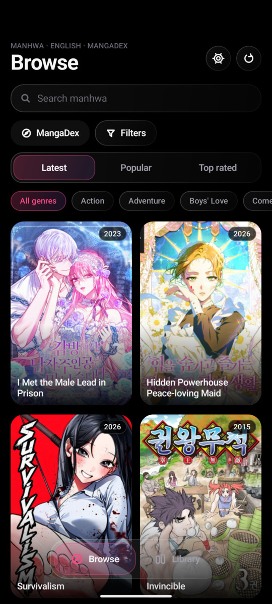
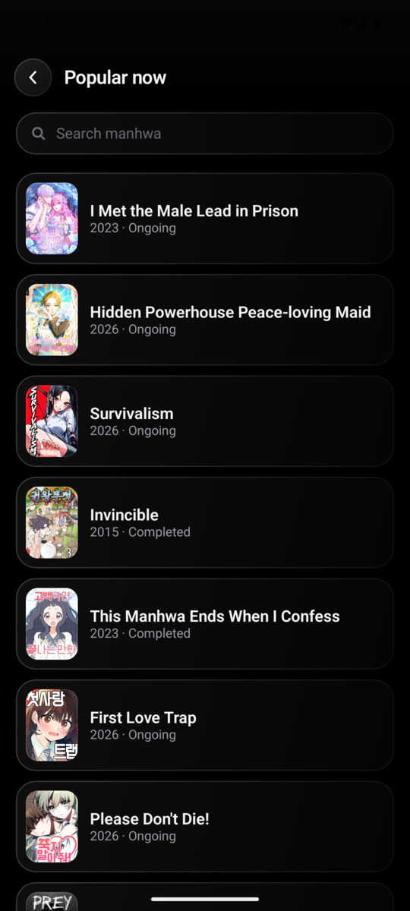
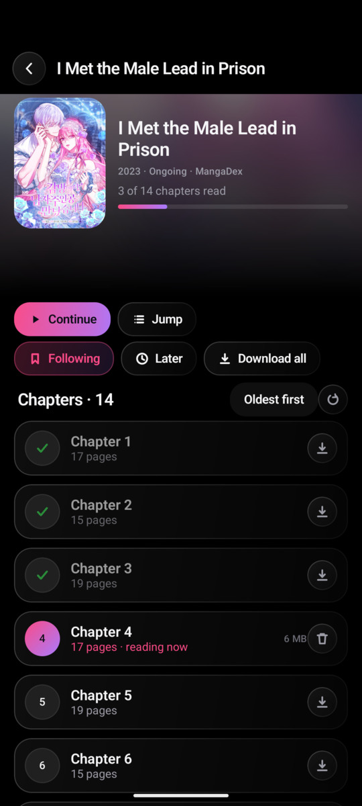
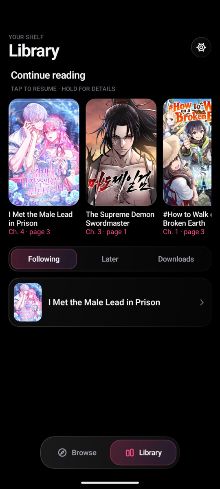
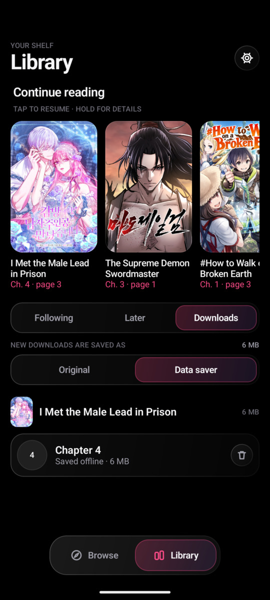
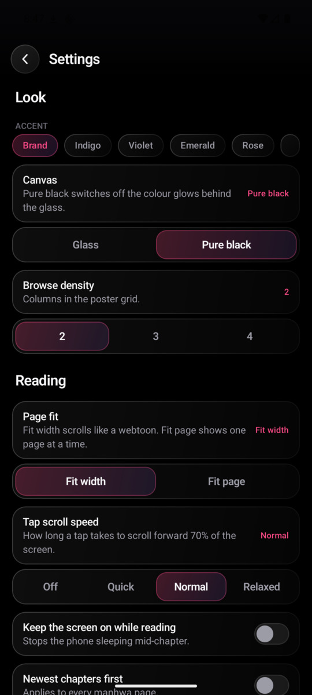
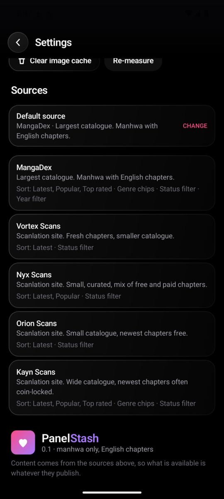
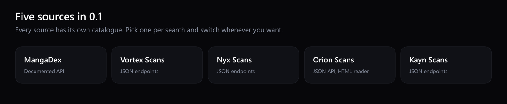
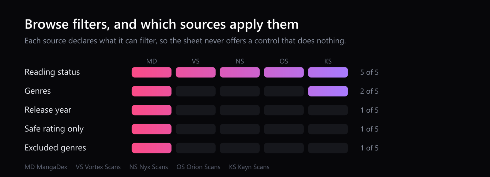

<div align="center">
  
</div>

<div align="center">


</div>

PanelStash is an Android app for reading manhwa. It renders chapters from five catalogue sources, keeps your place across them, and saves chapters to the device so you can read with no connection at all. There is no account and no server: everything it knows lives on the phone.

It is built for one hand and a slow connection. Pages arrive sized to the screen, a chapter reopens on the page you left, and a tap moves you forward a screenful.

## Screenshots

|  |  |
|:--:|:--:|
| <sub>Browse any source, with the sorts and filters that source can apply.</sub> | <sub>Search a source, or leave the field empty for its popular list.</sub> |
|  |  |
| <sub>Progress, follow, read later, download all, and a chapter list that marks what you finished.</sub> | <sub>A tap scrolls 70% of the screen. The bars follow the scroll direction.</sub> |
|  |  |
| <sub>Continue reading at the exact page, plus following, later and downloads.</sub> | <sub>Downloaded chapters live as files and open without a network.</sub> |
|  |  |
| <sub>Accent, canvas, grid density, page fit and tap scroll speed.</sub> | <sub>Every source lists what it can filter before you pick it.</sub> |

## What it does

Reading:

- Streams a chapter page by page, or reads it from disk when you have downloaded it.
- Remembers the chapter and the exact page, then offers Continue on the manhwa page.
- Marks a chapter read once you reach its last page, greys it out, and shows a ring at the end of a chapter that advances to the next one.
- Long-press toggles a chapter's read state, so a mis-tap does not lose your place in the list.
- Page fit is either fit width, which scrolls like a webtoon, or fit page, which shows one page at a time.

Library:

- Following and read-later shelves, both one tap from the manhwa page.
- Continue reading ordered by what you opened last.
- Downloads, with the quality used per chapter and the space taken.
- Deleting a download can be undone for five seconds.

Downloads:

- Whole comics download chapter by chapter, and each chapter is a normal file on the device.
- Original quality for the saved copy, data saver for streaming, or data saver for both.
- The queue waits for an unmetered connection by default and pauses when Wi-Fi drops.

Look:

- Five accent colours and two canvases: glass, with soft colour behind the panels, or pure black.
- Poster grid at two, three or four columns.
- Keep the screen awake while reading, and chapter lists either newest or oldest first.

## Sources

<div align="center">
  
</div>

MangaDex is the widest catalogue and the only one with a documented API. The other four are scanlation sites read through the JSON their own front ends request, which means they can change without notice. All five sit behind one interface, so the reader, the library and the downloads do not know which site served a chapter.

A source declares what it can do, and the filter sheet only offers those controls:

<div align="center">
  
</div>

Chapters are stored against the source that served them, so the same series from two sites is two entries rather than one mixed-up record. When a chapter is genuinely gone from one site, the app can offer the same chapter from another source before you start reading.

## Install

Grab the APK from the [releases page](https://github.com/ThoriaDevelopment/PanelStash/releases/latest), then open it on the phone and allow installing from this source when Android asks. The build is signed with a release key and targets Android 8.0 and newer.

There is no Play Store listing and no update check.

## Build from source

You need JDK 17 or newer and an Android SDK with platform 37 and a matching build-tools version.

```bash
git clone https://github.com/ThoriaDevelopment/PanelStash.git
cd PanelStash
./gradlew assembleDebug
```

On Windows use `.\gradlew.bat assembleDebug`. The APK lands in `app/build/outputs/apk/debug/`.

Unit tests cover the source mappings and chapter ordering:

```bash
./gradlew testDebugUnitTest
```

To build a signed release APK, create a key once and point the build at it. `keystore.properties` is not in version control, and neither are the `.jks` files:

```properties
# keystore.properties, at the repository root. Paths are relative to that root.
storeFile=panelstash-release.jks
storePassword=...
keyAlias=panelstash
keyPassword=...
```

Without that file the release build still runs and produces an unsigned APK, so nothing about signing is required to compile the project.

## What 0.1 leaves out

- New-chapter notifications and any polling for updates.
- Accounts, sync, and reading progress shared between devices.
- Titles without English chapters, and anything that is not manhwa.

## About the content

PanelStash ships no catalogue of its own. It reads what the five sites publish and keeps downloaded chapters on your device. The work itself belongs to the people who made it, and each site's terms still apply, so install and use it for what you are entitled to read.

## Licence

Apache 2.0. See [LICENCE.md](LICENCE.md).

## Credits

The [MangaDex](https://mangadex.org) API and the scanlation sites listed above, each of which sets its own access rules that the app follows. Built with [Kotlin](https://kotlinlang.org), [Jetpack Compose](https://developer.android.com/compose), [Ktor](https://ktor.io), [Room](https://developer.android.com/training/data-storage/room), [Coil](https://coil-kt.github.io/coil/), [WorkManager](https://developer.android.com/topic/libraries/architecture/workmanager) and [kotlinx.serialization](https://github.com/Kotlin/kotlinx.serialization).
